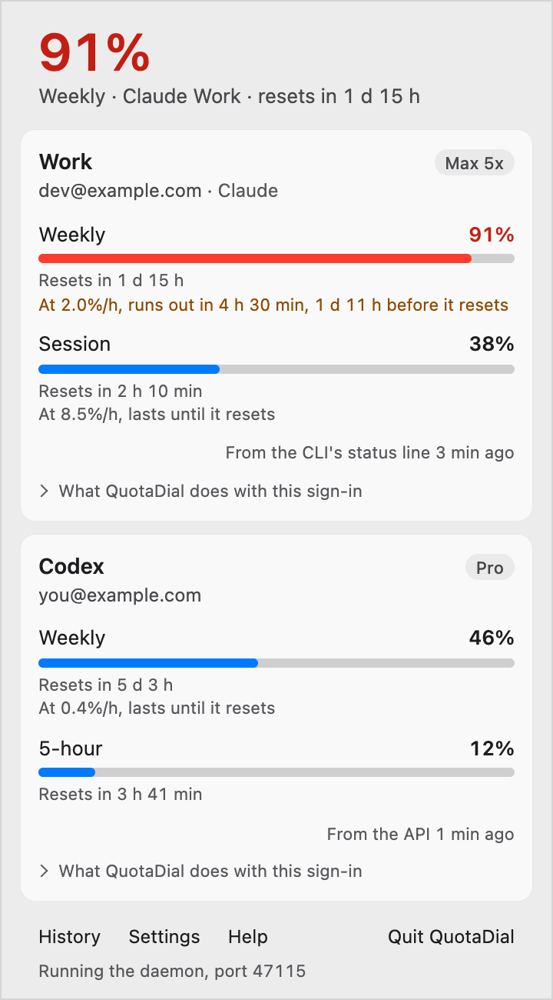

# QuotaDial

QuotaDial shows how much of your Claude, ChatGPT/Codex and Antigravity plan limits you have used,
and when they reset, so a long agent run does not stop halfway. It reads the login your Claude Code
and Codex CLIs already store and asks each provider for your current usage, keeps the numbers
Antigravity CLI's status line hands it, and puts the answer in your menu bar or system tray, in
your terminal, behind a local HTTP API, and in front of your agents through an MCP server and a
SKILL.md. It runs on macOS, Windows and Linux.

<p align="center">
  <picture>
    <source media="(prefers-color-scheme: dark)" srcset="site/public/images/app/accounts-dark.png">
    
  </picture>
</p>

**Status: pre-alpha.** `quotadial status` and `quotadial watch` show Claude, ChatGPT/Codex and
Antigravity usage. `quotadial daemon` polls for every consumer, keeps the history that gives each window its
pace (how fast it fills, and whether it runs out before it resets), checks alert rules written in
plain words (`quotadial alerts add "warn me at 80%"`), keeps 30 days of history (`quotadial
history`), watches the providers' status pages for incidents, works out what the week's local use
would have cost at API prices, and serves a local HTTP API, and
`quotadial mcp` is an MCP server for agents, with [a skill](skills/quotadial/SKILL.md) that tells
them how to use it, and `quotadial doctor` prints what support asks for. See
[docs/CLI.md](docs/CLI.md) for the commands, output and exit codes, and
[CHANGELOG.md](CHANGELOG.md) for what changed in each version. The tray app
([apps/tray](apps/tray)) shows the tightest limit in the menu bar or tray and runs the daemon
itself; see [docs/INSTALL.md](docs/INSTALL.md) to install or build it, and
[docs/ACCESSIBILITY.md](docs/ACCESSIBILITY.md) to use it by keyboard or screen reader.
Progress is tracked in the [milestones](https://github.com/pghmatt/quotadial/milestones), and the
product spec is in [docs/PRD-public.md](docs/PRD-public.md).

## QuotaDial Free and Pro

QuotaDial Free needs no key: one account per provider, every window with its pace and reset, 30
days of history, alerts for a share used, a reset and a sign-in, the providers' status pages, and
read-only status for agents through the CLI, the local API and MCP. QuotaDial Pro adds every
account on the machine, a year of history, a picture of an account's history to share, alerts
before a window runs out, before a reset and for incidents, alerts to webhooks and Slack, the
week's cost at API prices, and headroom and alert rules through the API and MCP. A licence key is
checked on your machine, with no call home, and a Free copy says in one line where each Pro
feature would be. See [docs/CLI.md](docs/CLI.md#quotadial-free-and-pro).

## Provider support

| Provider | Reads the login from | Status |
| --- | --- | --- |
| Claude | Claude Code (the macOS Keychain, `~/.claude/.credentials.json`, or `CLAUDE_CODE_OAUTH_TOKEN`), for every `CLAUDE_CONFIG_DIR` it finds | Works, with every stored subscription |
| ChatGPT / Codex | Codex CLI (`auth.json` in `$CODEX_HOME` or `~/.codex`) | Works |
| Gemini CLI | Nothing inside the sign-in: only that Gemini CLI's `oauth_creds.json` is in `.gemini` in `$GEMINI_CLI_HOME` or your home folder, and one field of its `settings.json` | Shown, with why it has no numbers |
| Antigravity | No sign-in: what Antigravity CLI's status line hands `quotadial antigravity status-line`, once you add it to Antigravity CLI's settings | Works while Antigravity CLI runs |
| GitHub Copilot | GitHub CLI (`hosts.yml` in `~/.config/gh`, when it keeps its sign-in there) or, on macOS, the Copilot CLI (the Keychain item `copilot-cli`) | Built, in no release yet: waits on a check with a real account |

Gemini CLI's account shows with no numbers. Signed in with Google, Google's terms do not let other
tools use Gemini CLI's sign-in, so QuotaDial never opens it and says where Gemini CLI shows its
limits (`/model`). A Gemini API key or Vertex AI has no plan limits to show.

Antigravity's terms do not let other tools use its sign-in either, so QuotaDial never reads it.
Antigravity CLI hands each limit's share and reset to a command named in its settings: add the
line [docs/INSTALL.md](docs/INSTALL.md#antigravity) gives, and its five-hour and weekly windows
show while Antigravity CLI runs, marked stale with the time they are from once it stops.

GitHub Copilot's limits are built: the month's AI credits used and when they reset, premium
requests on an annual plan, and Copilot Free's chat messages and code completions, from GitHub's
usage endpoint at most once every 5 minutes. They are in no release yet, since they wait on a check
with a real GitHub account; [docs/INSTALL.md](docs/INSTALL.md#copilot) says what they read.

If you keep several Claude subscriptions, each signed in through its own `CLAUDE_CONFIG_DIR`,
QuotaDial shows all of them, not only the one Claude Code uses now. See
[docs/CLI.md](docs/CLI.md#accounts) for where it looks.

QuotaDial only reads these sign-ins. It never writes, refreshes or moves them, and it never logs
them. When a sign-in has expired, run `claude` or `codex` once and QuotaDial picks up the refreshed
one.

Anthropic rate-limits its usage endpoint, so QuotaDial asks it at most once every 5 minutes per
account, and OpenAI at most once every 2 minutes, and backs off when told to. In between, it shows
the last numbers and says how old they are. When ChatGPT cannot be reached, QuotaDial shows the
newest numbers from the Codex CLI's own session logs, marked as coming from them.

<!-- privacy: copied from docs/PRIVACY.md by scripts/privacy.sh; edit it there -->

## What QuotaDial reads and sends

QuotaDial runs on your machine. It reads the sign-ins that Claude Code and the Codex CLI already
keep, and never writes, refreshes, moves or logs them. From the CLIs' session logs it reads only
numbers: token counts and model names for the week's cost, and the Codex CLI's own record of your
limits. What you and the model wrote never leaves the machine, and QuotaDial never reads it.

For Gemini CLI, QuotaDial reads no sign-in. It only checks that Gemini CLI's sign-in file,
`oauth_creds.json` in `~/.gemini`, is there, without opening it, and reads one field of Gemini CLI's
`settings.json` beside it: the one that says whether it signs in with Google, a Gemini API key or
Vertex AI. It asks no one about Gemini CLI and sends nothing about it.

For Antigravity, QuotaDial reads no sign-in and asks no one, and only checks whether Antigravity
CLI's folder, `~/.gemini/antigravity-cli`, is there, without opening anything in it; once you add
`quotadial antigravity status-line` to Antigravity CLI's status line, it keeps what the status line
hands that command, each limit's share or amount left and its reset, the plan and the account's
address, with the time, in `antigravity.json` in QuotaDial's data folder, readable only by you.

For Copilot, which is built but in no release yet, as it waits on a check with a real GitHub
account, QuotaDial reads the sign-in GitHub CLI keeps in `hosts.yml` in its folder, such as
`~/.config/gh`, when GitHub CLI keeps it there rather than in the system's keychain, or, on macOS,
the one the Copilot CLI keeps in the Keychain item `copilot-cli`, which macOS may ask you to allow.
It never writes, refreshes, moves or logs either, and never signs in to GitHub itself.

QuotaDial connects to these, and nothing else:

- **api.anthropic.com**, Anthropic's, with your Claude Code sign-in, for each Claude account's
  limits, at most once every 5 minutes per account.
- **chatgpt.com**, OpenAI's, with your Codex CLI sign-in, for your ChatGPT/Codex limits, at most
  once every 2 minutes.
- **api.github.com**, GitHub's, with your GitHub CLI or Copilot CLI sign-in, for each Copilot
  account's limits, at most once every 5 minutes per account, and only in a build with Copilot,
  which no release is yet. It is Copilot's usage endpoint, apart from **github.com** below, which
  is only for QuotaDial's own updates.
- **status.claude.com** and **status.openai.com**, the providers' public status pages, every 5
  minutes while `status_pages` is on. These carry no sign-in.
- **github.com**, where QuotaDial's releases are, once a day while the app's "Check for updates"
  is on, or when you check yourself; and **release-assets.githubusercontent.com**, where GitHub
  keeps the files, when you choose Update. These carry no sign-in and nothing about you or your
  usage. GitHub sees your IP address, as it does for any download.
- The **webhook and Slack addresses you add** to `config.json`, if you add any. Each gets every
  alert: what fired and its numbers, never a token or where a sign-in is kept.

Help's links, to Send feedback, the changelog and the support address, open in your own browser or
mail app, and only when you click them. Send feedback fills in a GitHub issue that you read before
you send it.

The local API answers only on this machine, at 127.0.0.1, and asks for QuotaDial's own token. The
MCP server talks only to the agent that starts it. QuotaDial's history, settings and licence key
stay on your machine, readable only by you. A picture made with History's Share image is drawn on
your machine and saved in your Downloads folder, and QuotaDial sends it nowhere. There are no
analytics, no crash reports and no account to make.

QuotaDial Pro is sold through Lemon Squeezy, which keeps the order. The link in your receipt opens
quotadial.com/key, which asks Lemon Squeezy whether the receipt's key is valid and gives you a
QuotaDial key, keeping and logging nothing. QuotaDial checks that key on your machine, with no
network call.

<!-- /privacy -->

## Build from source

You need Rust. [rustup](https://rustup.rs) installs the right toolchain from `rust-toolchain.toml`.

```sh
git clone https://github.com/pghmatt/quotadial
cd quotadial
cargo build --workspace --release
./target/release/quotadial status          # or the short alias: qd status
./target/release/quotadial status --json
./target/release/quotadial watch           # refreshes every minute; Ctrl-C to stop
./target/release/quotadial daemon          # one poller for everything, and the local API
```

To give Claude Code or Codex the MCP tools, with `quotadial` on your `PATH`:

```sh
claude mcp add quotadial -- quotadial mcp
codex mcp add quotadial -- quotadial mcp
```

Run the checks CI runs:

```sh
cargo fmt --all -- --check
cargo clippy --workspace --all-targets -- -D warnings
cargo test --workspace
```

## Attribution

QuotaDial's provider integrations are ported from
[CodexBar](https://github.com/steipete/CodexBar) by Peter Steinberger, used under the MIT License.
See [NOTICE](NOTICE).

## License

MIT. See [LICENSE](LICENSE).
